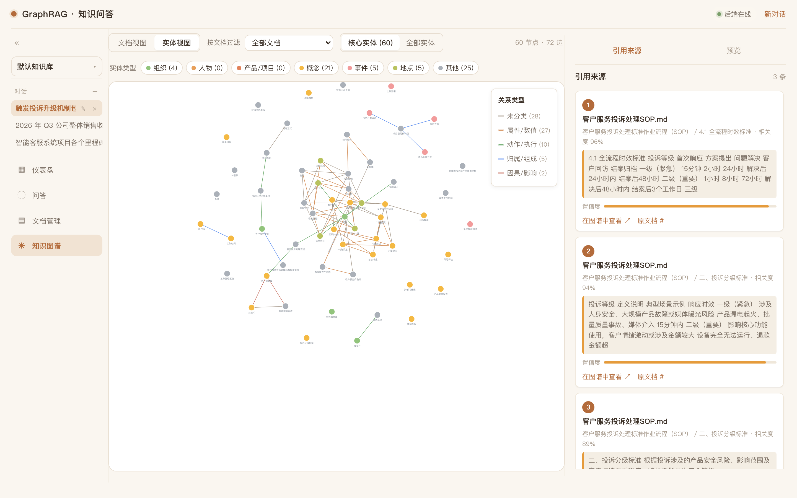
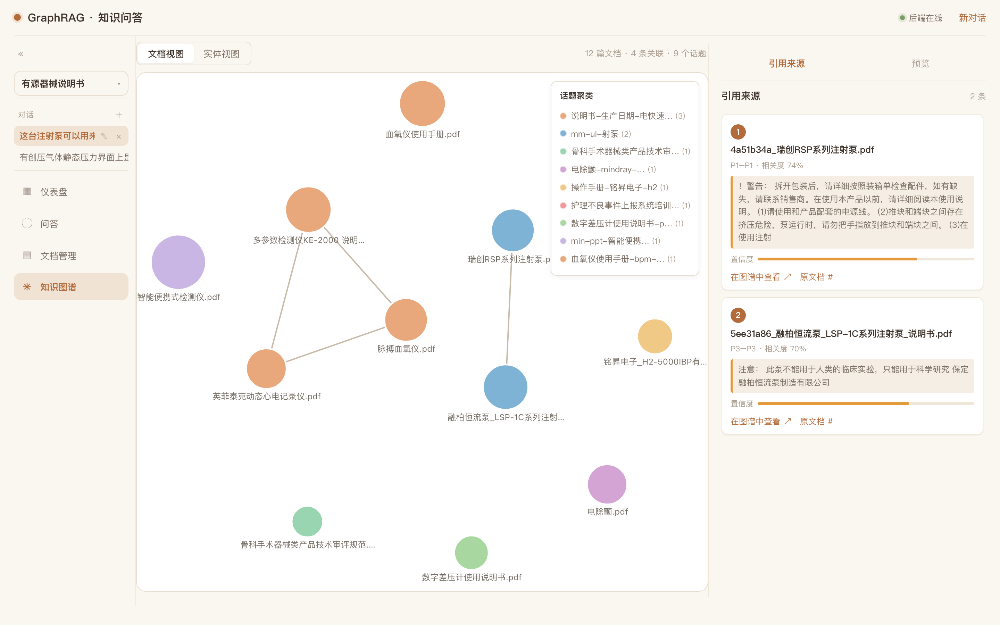
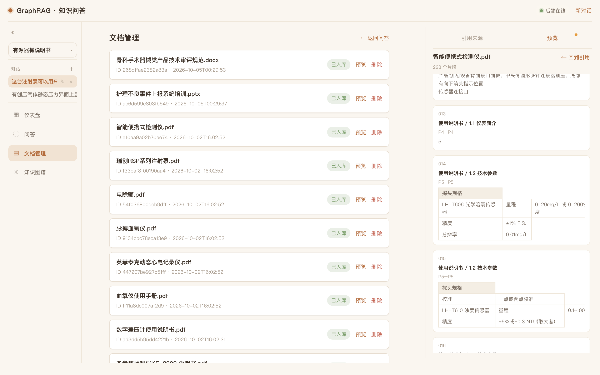
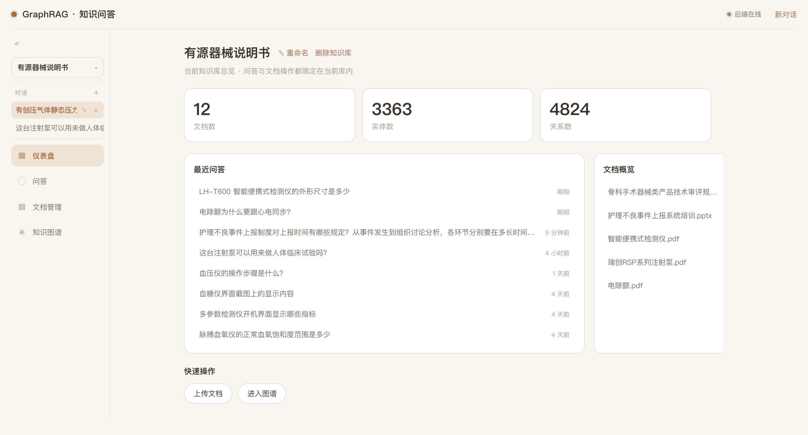
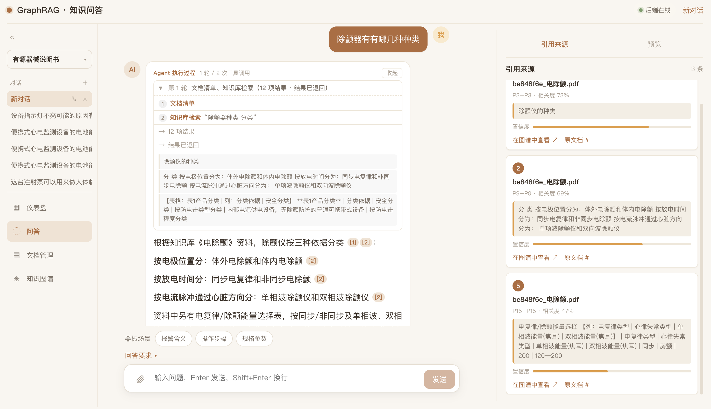
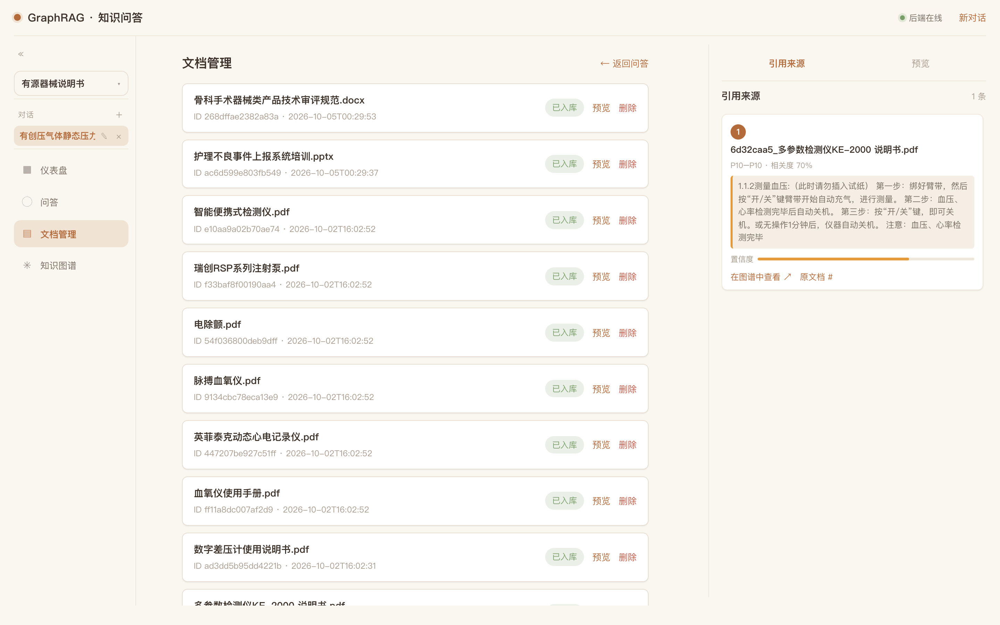

# GraphRAG

面向中文场景的**通用型图增强检索生成（GraphRAG）**系统 —— 基于 LightRAG 内核，支持多格式文档解析入库、双层知识图谱可视化、**多模态图片检索**、SSE 流式问答与 `[n]` 引用溯源。上层是**自研 agentic RAG**：由 LangGraph 状态机驱动的多轮工具决策，而不是「一次检索 + 一次生成」的固定流程。链路不绑定特定领域，已在**客服、行政、医疗器械**三个领域数据集上完成量化评测验证，获得可复用的通用 RAG 能力。

**四条设计主线**

- **混合召回**，不是单路向量：图 / 向量 / 稀疏三路召回 → RRF(k=60) → bge-reranker 全候选重排 → 五特征加权取 top5；表格数值类目 Precision **0.281 → 0.400**
- **Agentic 编排**，不是固定流程：LangGraph 状态图 + 原生 function calling 多轮决策，工具注册表可扩展；复杂题由规则注入三步计划（实测模型自主触发率 0/7）
- **可评测**，不是凭感觉：三领域 130 题 + 检索/生成 8 维指标 + 自研 gold_rank；LLM 裁判温度固定 0 + 判定缓存 + 证据强制，**版本间 Δ≤0.03 视为噪声**
- **可溯源**，不是幻觉兜底：`[n]` 角标逐句映射回 chunk → TextUnit → 原文页码，前端点击即跳转到原文片段

FastAPI + React/TypeScript 前后端分离；Postgres/pgvector 存储；bge-m3 向量（经 Xinference）；DeepSeek V4-Flash 生成与视觉理解。内置**量化评测体系**（检索 + 生成共八维指标，三库 130 题）。

**生产口径指标（三库 @5）**：检索 Recall **0.80–0.88** ｜ nDCG@5 **0.89–0.94** ｜ 生成 Faithfulness **0.978–0.998** ｜ 引用准确率 **0.86–0.90**

## 界面预览

> 以下均为真实运行截图（`有源器械说明书` 知识库）。问答页展示 agent 决策链（本轮 2 次工具调用：文档清单 + 知识库检索）、回答中的 `[n]` 角标，以及右侧可追溯到页码的引用面板。

| 知识图谱 · 实体级（`默认知识库`） | 知识图谱 · 文档级（`有源器械说明书`） | 表格预览 |
|---|---|---|
|  |  |  |
| 仪表盘 · 库概览 | Agent 问答（决策链回放 + 工具调用 + `[n]` 引用溯源） | 文档管理 |
|  |  |  |

## 功能特性

- **多格式解析**：PDF / DOCX / PPTX / XLSX / Markdown / HTML / TXT / EPUB 等，经 MinerU + Docling 统一结构化，图片型内容经视觉模型转写
- **Agent 问答**：LangGraph 状态机驱动多轮工具决策（检索 / 综合应答 / 文档清单）；复杂问句自动注入计划；答案带 `[n]` 引用标注，可溯源到原文片段
- **多轮对话**：会话以 LangGraph checkpoint 持久化（Postgres），跨轮复用已检索依据；切走会话/刷新不丢已生成的回答
- **知识图谱**：双层图谱（文档级 + 实体级），力导向布局，支持话题聚类 / 关系分类 / 实体筛选 / 图片节点预览，详见上「界面预览」
- **多模态检索**：文档图片入索引，图片型表格经视觉模型转写，带图内容可检索、可溯源
- **文档管理**：上传自动入库（解析 → 切块 → 建图），软删，多知识库隔离
- **仪表盘**：库概览统计 + 最近问答 + 文档概览
- **可观测**：每次 agent 运行的轮次 / 工具调用 / token 用量落 Postgres（`agent_runs` / `agent_spans`）
- **量化评测体系**：三库 130 题 @5 生产口径，检索 + 生成八维指标 + 自研 gold_rank（见下）

## 量化评测

M9 评测层（`backend/tests/`），指标与生产口径对齐（`@5` 单窗口，`RERANK_TOP=5`）。**链路不做领域定制**，直接以三套跨领域场景题集（客服 / 行政 / 器械）验证系统的通用知识问答能力：

- **检索四维**：Context Recall / Precision（含加权）/ nDCG@5 / 自研 **gold_rank**（事实最早命中位次）
- **生成四维**：Faithfulness / Answer Relevance / Correctness / Citation Accuracy
- **Agent 专项**：tool_accuracy（工具选择是否正确）+ multi_hop_recall（多跳题的事实覆盖）
- **裁判可靠性工程**：P0 证据强制、P1 数字纪律、假阳性清理（裁判温度固定 0 + 判定缓存 → 确定性复现）；**版本间 Δ ≤ 0.03 视为噪声**

下表为 **M6 直连线**（单次检索 + 单次生成，作为对照基线）的三库结果；agent 线指标与逐版本对比见 [`docs/modules/M9_evaluation.md`](docs/modules/M9_evaluation.md) 与 [`docs/modules/M10_agent.md`](docs/modules/M10_agent.md)。

| 题集 | 检索 Recall | nDCG@5 | 生成 Correctness | Faithfulness | 引用准确率 |
|---|---|---|---|---|---|
| 客服（50 题） | 0.8000 | 0.9377 | 0.8149 | 0.9975 | 0.8594 |
| 行政（30 题） | 0.8363 | 0.8935 | 0.9222 | 0.9777 | 0.8753 |
| 器械（50 题） | 0.8833 | 0.9305 | 0.8733 | 0.9950 | 0.8960 |

> 三库题集**难度形状不同**（客服以 medium 为主、行政以 easy 为主、器械均衡 5:3:2），**不可拿 aggregate 绝对值横比**，应按难度 / 题型分层读取。完整口径与结论见 [`docs/modules/M9_evaluation.md`](docs/modules/M9_evaluation.md)。

## 快速开始

```bash
# 一键启动全套（PG → Xinference → 后端 → 前端）
./dev.sh start

# 或手动分步：
cd backend
conda activate graphrag
cp .env.example .env          # 填入 DEEPSEEK_API_KEY
python -m app.m7_interact.runner --port 8787   # 后端 http://localhost:8787/swagger

cd ../frontend
npm install
npm run dev                   # 前端 http://localhost:5173
```

前置依赖：Docker（Postgres + pgvector）、Xinference（bge-m3 向量模型）、DeepSeek API Key。

## 架构

```
索引管线（离线）
  原始文档 → [M1 解析] → [M2 切块] → [M3 索引] → [M4 存储]
              （图片视觉转写）        （图 + 向量双索引）

查询管线（在线）
  用户问题 → [M10 Agent 编排：LangGraph 状态图]
                  ├─ 计划分支：规则判定为复杂题 → 注入三步计划，每轮回注 + 生成前覆盖核对
                  ├─ tool_retrieve   → [M5 检索]
                  ├─ tool_rag_answer → [M5 检索] + [M6 生成]
                  └─ tool_list_docs  → [M7 文档列表]
                  ↓ 多轮决策后生成答案
              [M7 交互层 SSE] → [M8 前端]
```

- 索引管线（离线）：MinerU/Docling → TextUnit → LightRAG 图索引 + bge-m3 向量；图片经 DeepSeek 视觉转写独立成块
- 查询管线（在线）：agent 每轮依据工具返回决定下一步 → 检索侧三路召回 → RRF → rerank → 五特征融合 → DeepSeek 生成 + 引用标注
- 计划分支**不是工具**：由代码规则（问句长度 / 多问句 / 对比词）判定，命中后写进图状态并在每轮路由前回注，不占模型的选择权
- M6 直连生成保留为 `tool_rag_answer` 的内部落点与评测对照组，不作为独立入口

详细架构见 [`docs/ARCHITECTURE.md`](docs/ARCHITECTURE.md)；模块划分见 [`docs/FRAMEWORK_NOTES.md`](docs/FRAMEWORK_NOTES.md)。

## 关键技术实现

**1. 三路混合召回 + 两级排序**

单路向量召回对中文专名、条款编号、表格数值容易漏。系统同时跑三路：图检索（沿实体/关系扩张）、向量检索（bge-m3 dense 语义召回）、关键词检索（bge-m3 sparse 稀疏向量，等价 BM25 但不用另建索引）。三路结果用 **RRF（Reciprocal Rank Fusion，按名次倒数相加融合，k=60）** 合成一个候选池——只看名次不看各家分数，避免不同打分尺度无法直接相加的问题。

候选池再走两级排序：bge-reranker 交叉编码器给全候选打语义分（不截断），然后**五特征融合**（rerank 语义分 / sparse 内积 / rrf 位次 / `numeric_match` / `numeric_density`）加权定 top-5。加后两个数值特征是因为交叉编码器对「120–200 焦耳」这类表格数值近乎失明，纯语义分会把表格题排掉。

**2. 引用溯源链路**

检索命中携带 `(doc_id, chunk_id, text_unit_id, page_range)`，一路传进 prompt 的资料清单；模型被要求在论断后标 `[n]`，解析层再把 `[n]` 还原成 chunk → TextUnit → 原文页码/标题路径，前端点角标即可跳到原文片段。跨多个资料块的论断要求并列标注多个编号（`[1][2]`），否则裁判/用户只能核到其中一块。

**3. Agent 编排（LangGraph 状态图）**

```
START → route ──(决定调工具)──→ execute_tools ──┐
          │                                    │
          └──(信息足够)──→ generate → END  ←────┘
```

- **route / execute_tools / generate** 三个节点，route 用 v4-flash 的原生 function calling 选工具，最多 5 轮，防止无限自问自答
- **工具注册表**自研（agent 与底座的唯一接缝）：`tool_retrieve` / `tool_rag_answer` / `tool_list_docs`，都是对 M5/M6/M7 现有能力的薄封装
- **状态持久化**用 LangGraph checkpointer 落 Postgres（`thread_id = conversation_id`），多轮历史与上一轮引用池从 checkpoint 恢复，而不是每次重塞全文历史
- **计划分支（不是工具）**：复杂题（问句 >35 字 / 多问句 / 含对比词）由代码规则判定，命中后写进图状态一份三步计划（拆解 → 逐项检索 → 汇总标注引用），每次路由前回注、生成前做步骤覆盖核对。原本注册成 `tool_plan` 让模型自己决定，实测 7 次采样 0 触发——小模型不选元工具，只能改由规则兜住；触发组耗时 +46%，收益要靠跨文档对比类复杂题验证

**4. 流式与断连兜底**

后端用 SSE 逐 token 推送，事件序列为 `tool_decision → tool_result → delta → citations → done`，前端据此渲染决策链折叠卡片。生成与落库放在后台 task 里：客户端切会话/刷新导致连接断开时，**已发出的 LLM 调用继续跑完并写库**，下次进会话能看到完整那一轮（否则连接一断，生成中的这一轮就永久丢失）。

**5. 评测与裁判校准**

LLM-as-judge 有随机性：同一个引用在不同采样下可判出 0.90 / 0.00 两极化。做法是裁判温度固定 0 + 判定结果缓存 + 证据强制（判「有依据」必须引用原文片段），并把**版本间差异的显著性门槛定为 Δ > 0.03**——低于这个数的波动视为噪声，不作为改动依据。

**6. 多模态索引**

图片经视觉模型（DeepSeek V4-Flash）转写成文字描述，与正文一样切块入库；检索命中图片块时前端展示缩略图并可在图谱中预览。这样「表格截图」「流程图」也能被检索到，而不只是 PDF 里的文本层。

**7. 前端渲染**

回答区用 `react-markdown` + `remark-gfm` 渲染（模型输出本就是 Markdown）；引用角标交给自写 remark 插件处理——在语法树上把 `[n]` 拆成链接节点再替换为可点击按钮，代码块里的 `[n]` 不动。全程不注入 `innerHTML`。

## 项目结构

```
GraphRAG/
├── backend/            # Python 后端（FastAPI + LightRAG + LangGraph）
│   ├── app/            # M1–M10 业务代码（解析 / 切块 / 索引 / 存储 / 检索 / 生成 / 交互 / agent）
│   ├── tests/          # M9 评测层（题集 / 报告 / 指标）
│   └── environment.yml # conda 环境
├── frontend/           # React + TypeScript + Vite 前端
├── docs/               # 架构 / 模块 / 评测 / 变更日志
└── dev.sh              # 一体化开发启动脚本
```

## 技术栈

| 层 | 技术 |
|----|------|
| 解析 | MinerU（PDF / 图片 / DOCX / PPTX / XLSX）+ Docling（HTML / Markdown / TXT / EPUB / DOC）+ DeepSeek 视觉（图片转写） |
| 索引 | LightRAG + bge-m3（dense + sparse，经 Xinference） |
| 存储 | Postgres + pgvector（图 / 向量 / 原文 / 会话 checkpoint 同库） |
| 检索 | 三路召回 + RRF 融合 + bge-reranker-v2-m3 + 五特征融合排序 |
| Agent 编排 | LangGraph（StateGraph + Postgres checkpointer）+ v4-flash 原生 function calling |
| 生成 / 视觉 | DeepSeek V4-Flash（文本生成 + 图片理解，关思考模式） |
| 后端 | FastAPI + SSE |
| 前端 | React 19 + TypeScript + Vite + AntV G6 5 + react-markdown |
| 评测 | 自研 M9 评测层（三库 130 题 + LLM 裁判 + 温度固定 0 的判定缓存） |

## 文档导航

| 你想找什么 | 看这里 |
|-----------|--------|
| 架构总览 / 选型决策 | [`docs/ARCHITECTURE.md`](docs/ARCHITECTURE.md) |
| 模块划分 / 文档治理规则 | [`docs/FRAMEWORK_NOTES.md`](docs/FRAMEWORK_NOTES.md) |
| 各模块接口契约 / 关键决策 / 已知坑 | [`docs/modules/`](docs/modules/) |
| Agent 编排设计（LangGraph 状态图 / 工具注册表 / 记忆） | [`docs/modules/M10_agent.md`](docs/modules/M10_agent.md) |
| 版本历史 / 变更记录 | [`docs/CHANGELOG.md`](docs/CHANGELOG.md) |
| 前端需求文档 | [`docs/modules/M8_frontend_req.md`](docs/modules/M8_frontend_req.md) |
| 图谱优化方案 | [`docs/modules/GRAPH_OPTIMIZATION_v4.md`](docs/modules/GRAPH_OPTIMIZATION_v4.md) |
| API 契约 | 启动后端后访问 `http://localhost:8787/swagger` |